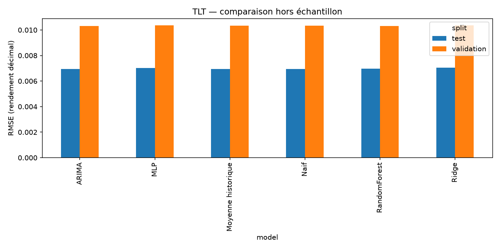
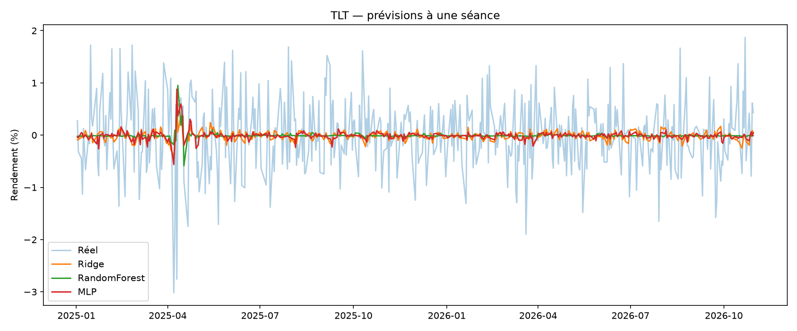

# D05 — Machine Learning et Deep Learning (B07 — TLT)

## Objectif
Comparer Ridge, Random Forest et un MLP PyTorch aux références naïve, moyenne historique et ARIMA(1,0,1) de D03, sur la même cible : rendement journalier de TLT à une séance. Les prévisions sont datées de la séance cible `Date` ; `signal_date` est la séance précédente, après clôture. Ce travail ne démontre pas encore la rentabilité d'une stratégie.

## Exécution
Depuis la racine du dépôt, avec le snapshot D02 et les exports D03 déjà présents :

```bash
python -m pip install -r requirements_d05.txt
python -m src.ml_dl
python -m pytest tests/test_ml_dl.py -v
```

Utiliser un environnement Python compatible avec PyTorch (par exemple Python 3.11 ou 3.12 si une roue n'est pas disponible pour votre version). Aucun téléchargement de données nécessaire. Les résultats ci-dessous proviennent de l’exécution locale sous Windows avec Python 3.15.2. Les versions des bibliothèques sont consignées dans le fichier `reports/D05/configuration.json` généré localement. Les durées varient selon la machine ; les résultats numériques peuvent légèrement varier selon les versions.

## Protocole temporel
- Apprentissage : 2018–2022, 1 238 observations après amorçage des fenêtres glissantes.
- Validation : 2023–2024, 502 observations. Quatre configurations par famille, sélection sur RMSE minimale.
- Test : 2025–30/10/2026, 459 observations, mêmes dates et rendements réels que D03 (assertions dans le script).
- Réentraînement sur apprentissage + validation avec les hyperparamètres gelés. Aucune adaptation sur le test. Les observations passées du test peuvent alimenter les variables retardées des séances suivantes ; elles ne réestiment pas les paramètres.
- Standardisation ajustée uniquement sur la période d'ajustement du modèle ; cible MLP standardisée puis reconvertie en rendement décimal. Seed 42. Les minibatches MLP sont mélangés uniquement à l'intérieur de l'échantillon d'apprentissage.

## Variables et modèles
24 variables (12 par actif TLT/SPY) : rendements retardés 1, 2, 3, 5 ; moyennes et écarts-types sur 5, 10, 20 séances ; momentum 5 séances et écart relatif à la moyenne mobile 20 séances. Toutes les variables sont décalées pour exclure les données de la séance cible.

| Modèle | Grille | Configuration retenue |
|---|---|---|
| Ridge | alpha 1, 10, 100, 1000 | alpha 1000 |
| Random Forest | 100 arbres ; profondeur 3/6 ; feuille 10/30 | 100 arbres, profondeur 3, feuille 10 |
| MLP | 24 entrées ; première couche 8/16 ; seconde 8 ; 20/60 époques | 24-8-8-1, 20 époques |

MLP : ReLU, Adam, learning rate 0,001, weight decay 0,001, batch 64, MSE. Ridge : régularisation L2. Random Forest : moyenne des prédictions des arbres. Références : rendement nul, moyenne historique fixe et ARIMA de D03. La moyenne historique utilise l'échantillon commun disponible après amorçage.

## Résultats
MAE et RMSE en rendement décimal ; direction = égalité des signes (le naïf nul n'annonce pas de hausse/baisse, son score compte seulement les rendements exactement nuls).


### Validation

| Modèle | MAE | RMSE | Direction (%) | Ajustement (s) | Prédiction (s) |
|---|---:|---:|---:|---:|---:|
| RandomForest | 0.008252 | 0.010300 | 48.61 | 0.990212 | 0.015353 |
| ARIMA | 0.008246 | 0.010317 | 48.80 | N/D | N/D |
| Moyenne historique | 0.008267 | 0.010338 | 49.40 | 0.000000 | 0.000000 |
| Naif | 0.008267 | 0.010338 | 0.40 | 0.000000 | 0.000000 |
| Ridge | 0.008292 | 0.010354 | 50.20 | 0.009875 | 0.004521 |
| MLP | 0.008344 | 0.010366 | 47.01 | 5.119220 | 0.007000 |

### Test

| Modèle | MAE | RMSE | Direction (%) | Ajustement (s) | Prédiction (s) |
|---|---:|---:|---:|---:|---:|
| ARIMA | 0.005415 | 0.006946 | 51.85 | N/D | N/D |
| Naif | 0.005422 | 0.006953 | 0.22 | 0.000000 | 0.000000 |
| Moyenne historique | 0.005422 | 0.006953 | 49.46 | 0.000000 | 0.000000 |
| RandomForest | 0.005400 | 0.006982 | 50.11 | 2.200235 | 0.153197 |
| MLP | 0.005391 | 0.007012 | 51.63 | 3.676948 | 0.008199 |
| Ridge | 0.005469 | 0.007049 | 48.58 | 0.007077 | 0.003269 |

Random Forest est retenu selon la RMSE de validation, avant comparaison finale. Sur le test, ARIMA obtient la plus faible RMSE ; le MLP obtient la plus faible MAE. Aucun changement de modèle ne doit être décidé sur la seule base du test. Les écarts sont faibles et leur significativité n'est pas établie. Les temps ARIMA ne sont pas disponibles dans D03 ; les temps des références simples sont notés zéro par convention et ne sont pas des chronométrages. Les durées des candidats sont dans [ hyperparametres.csv ](reports/D05/hyperparametres.csv).





## Fichiers et vérification
- `src/ml_dl.py` : construction des variables, modèles, sélection et évaluation.
- `tests/test_ml_dl.py` : causalité des variables, standardisation, reproductibilité du MLP (3 tests passés en 19,09 s lors de l’exécution locale).
- [ comparaison.csv ](reports/D05/comparaison.csv) : métriques par période et modèle.
- [ hyperparametres.csv ](reports/D05/hyperparametres.csv) : 12 essais sur validation, durées incluses.
- [ configuration.json ](reports/D05/configuration.json) : paramètres retenus, variables, seed, versions.
- [ previsions.csv ](reports/D05/previsions.csv) : prévisions datées, cible, modèle et période. Pour ARIMA, seules les prévisions test sont exportées car D03 ne fournit que les métriques de validation.

## Tests automatisés

| Test | Résultat |
|---|---|
| `test_causal_features` | PASSED |
| `test_scaling` | PASSED |
| `test_mlp_seed` | PASSED |

Bilan local : **3 tests réussis en 19,09 s**, aucun échec.

## Conclusion et limites
Les modèles complexes n'améliorent pas systématiquement la prévision. La fenêtre de calcul réduit légèrement l'échantillon d'apprentissage ML/DL par rapport à ARIMA. Les données ajustées proviennent du snapshot D02 et ne constituent pas une base point-in-time indépendante. Les mesures de direction ne suffisent pas à établir un avantage économique. D06 devra confronter une règle directionnelle et une règle filtrée par le risque D04, avec frais et glissement, sans sélectionner les règles sur le test final. Les rendements clôture-à-clôture ne sont pas directement des rendements exécutables à l'ouverture suivante.
